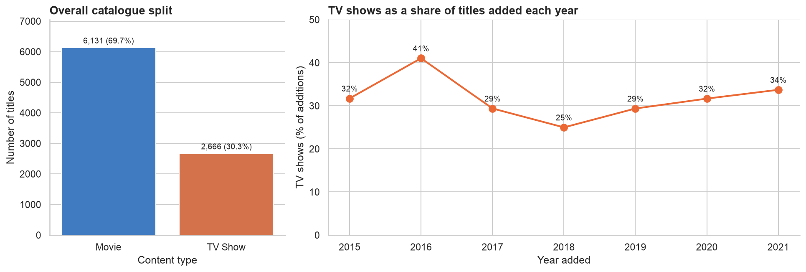
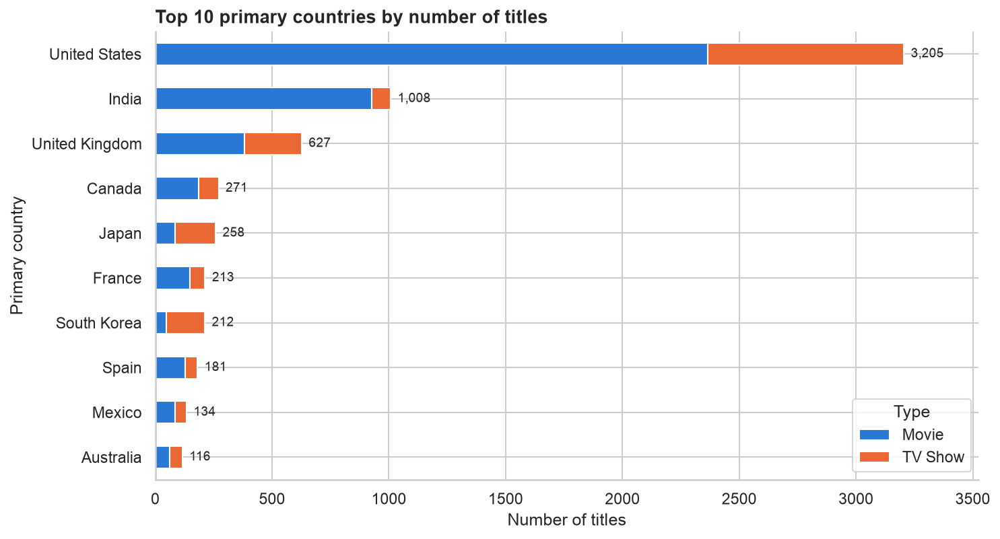
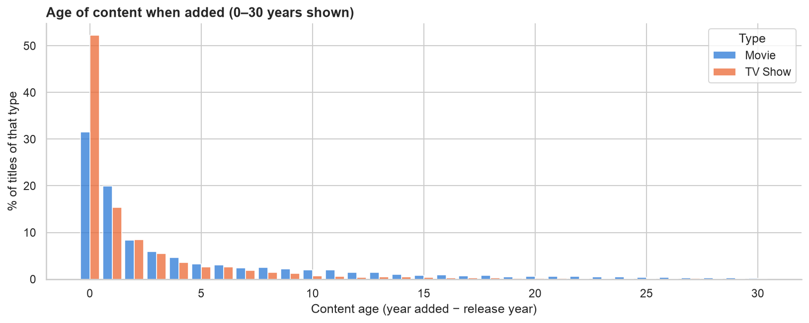

# Netflix Movies & TV Shows: Exploratory Data Analysis

An end-to-end exploratory data analysis of the Netflix catalogue (8,807 titles, snapshot to 25 September 2021) using Python, Pandas, Matplotlib and Seaborn. The notebook profiles the raw data, investigates missing values and their causes, fixes data-entry errors, engineers new features (runtime vs seasons, primary country, content age, exploded genres), checks for outliers, and answers six concrete questions with nine charts. Every interpretation is backed by numbers computed in the notebook.

## Dataset

- **Source:** [Netflix Movies and TV Shows on Kaggle](https://www.kaggle.com/datasets/shivamb/netflix-shows) (Shivam Bansal)
- **File:** `data/netflix_titles.csv`, 8,807 rows × 12 columns, about 3.4 MB (committed so the notebook runs straight after cloning)
- **Columns:** `show_id`, `type`, `title`, `director`, `cast`, `country`, `date_added`, `release_year`, `rating`, `duration`, `listed_in` (genres), `description`

## Questions explored

1. How is the catalogue split between movies and TV shows, and has the mix shifted over time?
2. How quickly did Netflix grow its catalogue (titles added per year)?
3. Which countries produce the most content, and does the movie/TV mix differ by country?
4. How long are movies, and how many seasons do TV shows usually run?
5. Which genres and maturity ratings dominate, and do they differ between movies and TV shows?
6. How old is content when it's added, and which months see the most additions?

## Key findings

- **Missing director data is structural:** 91.4% of TV shows have no director, compared with 3.1% of movies.
- **The TV push dipped, then recovered:** TV shows were 41% of additions in 2016, 25% in 2018, and back up to 33.7% in 2021.
- **Country shapes format:** India is 92.0% movies, while South Korea (77.8%) and Japan (67.1%) are mostly TV shows.
- **Content arrives fresh:** 36.8% of titles were added in their release year and 55.0% within one year (median TV show age 0 vs 2 years for movies).
- **Most series end after one season:** 67.3% of TV shows have a single season. Additions peaked at 2,016 titles in 2019.
- **Mature audiences dominate:** TV-MA is the top rating (36.4%), and adult-only ratings make up 45.5% of the catalogue.

## Selected charts







All 12 figures are in [`images/`](images/).

## Project structure

```
netflix-eda/
├── data/
│   └── netflix_titles.csv     # raw Kaggle dataset
├── images/                    # PNG copy of every chart in the notebook
├── netflix_eda.ipynb          # the analysis (committed with outputs)
├── requirements.txt
├── README.md
└── .gitignore
```

## How to run

```bash
git clone https://github.com/VaishnavK9/netflix-eda.git
cd netflix-eda
python3 -m venv .venv
source .venv/bin/activate        # Windows: .venv\Scripts\activate
pip install -r requirements.txt
jupyter notebook netflix_eda.ipynb
```

To re-execute the whole notebook from the command line:

```bash
jupyter nbconvert --to notebook --execute --inplace netflix_eda.ipynb
```

## Notebook outline

1. Introduction and questions
2. Structural overview: shape, dtypes, `info()`, memory, head/tail, duplicates
3. Missing value analysis: table, bar chart, heatmap, handling strategy
4. Cleaning and feature engineering
5. Summary statistics and IQR outlier check
6. Visualisations: 9 question-driven charts, each with an interpretation
7. Key findings and limitations

## Tech stack

- Python 3
- Pandas, NumPy
- Matplotlib, Seaborn
- Jupyter Notebook

## Author

**Vaishnav Kumbhar**

- GitHub: [@VaishnavK9](https://github.com/VaishnavK9)
- LinkedIn: [/in/vaishnav-kumbhar](https://www.linkedin.com/in/vaishnav-kumbhar)
